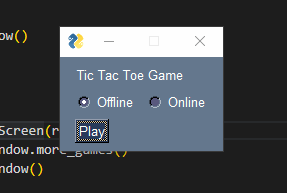

# :video_game: Tic Tac Toe

Jogo da velha em Python, em duas versões:

- **[v1_without_GUI](./v1_without_GUI)** — versão de terminal, com um computador
  imbatível (minimax) ou dois jogadores.
- **[v2_with_GUI](./v2_with_GUI)** — versão com interface gráfica, incluindo
  modo online para jogar com um amigo pela rede.

Cada pasta tem seu próprio README com instruções.

## :green_book: V1 — Terminal

Contra o computador (imbatível) ou dois jogadores no mesmo PC.

```sh
cd v1_without_GUI
python main.py
```

## :green_book: V2 — Interface gráfica

Offline (sozinho ou com um amigo no mesmo PC) ou online pela rede.

```sh
cd v2_with_GUI
pip install -r requirements.txt
python main.py
```


