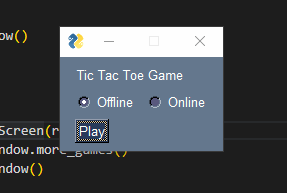

# :full_moon: Tic Tac Toe — Interface gráfica

Versão com interface gráfica, feita com **FreeSimpleGUI** (fork livre e
compatível do antigo PySimpleGUI, que passou a exigir licença paga).



## :bike: Como rodar

```sh
pip install -r requirements.txt
python main.py
```

Requer Python 3 com Tkinter (já incluso na maioria das instalações; no Linux,
pode ser preciso `sudo apt install python3-tk`).

## :star: Offline

Escolha jogar sozinho (contra outra pessoa no mesmo PC) ou com um amigo na
mesma máquina, e quem começa. O jogo então inicia.

## :star2: Online

Um jogador cria a partida e o outro se conecta pelo IP. Quem se conecta é o
Jogador 1; quem cria é o Jogador 2.

> **Obs.:** evite clicar na janela quando não for sua vez — nesse momento o
> jogo está esperando a jogada do outro jogador.

## :books: Regras

- Os jogadores se alternam escolhendo casas livres do tabuleiro.
- Vence quem completar uma linha, coluna ou diagonal.
